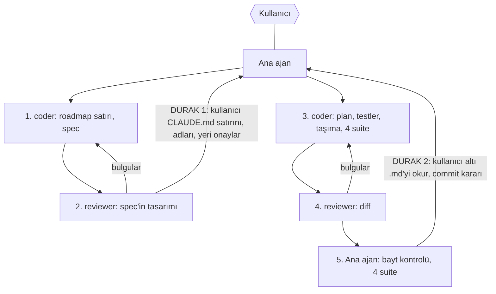

# 495 — Altı model metni prompt.py'den .md dosyalarına

**Tarih:** 2026-10-23 · **Dal:** `feat/queenagent-v11` (mevcut checkout, worktree yok) · **Madde:** 495 · v11-7
**İstek** *(kullanıcı, 23 Ekim)*: "bu skilleri ve seçilebilen skilleri ayrı bir md mi yapsak ben okurdum direkt ... rahat olurdu repoda oradan okusa"; "şimdilik ilk 6 dosyayı taşıyalım".

## Ajanlar

Tek ajan aynı anda çalışır. QA yok: ekran değişmiyor.

## Kapsam

- **Taşınan, tam altı metin:** `START_A_SCENARIO`, `EDIT_PROMPTS`, `KREA_START_SCENARIO`, `KREA_EDIT`, `SDXL_GUIDE`, `KREA_GUIDE`.
- **İki belgenin adı aynı kalır:** `sdxl-prompt-writing.md`, `krea-prompt-writing.md` (dosya panelinde bu adlarla görünüyorlar).
- **Kodda kalan:** `SYSTEM_PROMPT` ve `system_prompt()` (her istekte kuruluyor, suffix ekleniyor — kullanıcı: "dosya yokken bir kısmı farklı oluyor, suffix ekleniyor vs"), `CHECK`, araç açıklamaları, tek satırlık metinler (`LAST_ROUND`, `FILES_HELD`, …).
- **Tek kelime değişmez.** Modele giden içerik bayt bayt aynı kalır.
- **Klasör ve dört skill dosyasının adı coder'ın kararı** (spec'te). Önerilen: `queen-agent/backend/features/workspace/skills/`, adlar picker id'leri gibi (`start-a-scenario.md`, `edit-prompts.md`, `krea-start-scenario.md`, `krea-edit.md`).
- **Neyin değişmeyeceği:** ekran, `dist`, picker id'leri, `GUIDES` haritasının dışa verdiği adlar ve metinler, araçlar.

## Spec'in karar vereceği üç şey (coder)

1. **Okuyan kod nerede durur.** `CODE-STANDARD.md`: domain "no file-path knowledge" bilmez; `prompt.py`'nin kendi docstring'i "imports nothing, and will not" ve 492'nin yorumu "files in the repo would need a port the domain does not have" diyor. Spec bunu açıkça çözer (ör. dosyaları okuyan küçük bir yükleyici ve yeri, ya da `main.py`). Bir kural değişecekse ya da bir kural cümlesi (`CODE-STANDARD.md` 46–47, `prompt.GUIDES`) yanlış kalacaksa, spec önerir ve 1. durakta gösterilir. Var olan kodu yeniden yapılandırmak gerekirse coder önce sorar.
2. **Why-yorumları nereye gider.** `prompt.py`'deki bu sabitlerin yanındaki yorumlar (tarih, madde numaraları, kullanıcının alıntılanmış sözleri) modelin okuduğu `.md`'ye giremez. Yer coder'ın kararı (ör. `prompt.py`'de yükleyicinin yanında, ya da ayrı bir not); **hiçbir şey kaybolmaz.**
3. **Bayt eşitliği nasıl kanıtlanır.** Taşımadan önce altı sabitin değeri commit'li `prompt.py`'den alınır; taşımadan sonra okunan metinlerle karşılaştırılır. Dikkat: dosya sonundaki satır sonu (sabitler `\n` ile bitmiyor), Windows'ta CRLF (repoda `.gitattributes` yok), UTF-8. Kalıcı bir hash testi değil — gelecekte metin değişince kırılır; tek seferlik kontrol `tmp/`'de, ya da spec daha iyisini önerir.

## CLAUDE.md satırı

`CLAUDE.md`'de "Tests cover code. Documents are for people … (item 431)" kuralı var. Bu `.md`'ler insan için belge değil, modelin girdisi; kod okur, testler sabit gibi okur. Coder bir satırlık istisnayı spec'e yazar, **kullanıcı görmeden CLAUDE.md'ye yazılmaz.** Taslak:

> The exception is the `.md` files in `queen-agent/backend/features/workspace/skills/`: they are the model's input, read by the code, and tests read them as they read any constant (item 495).

## Adımlar

- [x] 1. Ana ajan coder'a brif verir: bu plan, roadmap, kullanıcının 23 Ekim sözleri, yukarıdaki üç karar noktası, testlerin listesi (aşağıda).
- [x] 2. Coder roadmap'e 495 · v11-7 satırını ekler: Türkçe, kullanıcının tarihli sözleri, `ALIGNED` *(23 Ekim)*, "Bitti sayılır" görünen sonuçla — altı `.md` repoda açılıp okunuyor, ajan ve dosya paneli aynı metni görüyor, dört suite yeşil. Başlıktaki "Sıra"ya 6. satır; "Durum" şimdilik 5/6.
- [x] 3. Coder spec yazar: `docs/specs/2026-10-23-queen-agent-m495-skill-md-design.md` — klasör, adlar, yükleyicinin yeri, yorumların yeri, bayt kanıtı, CLAUDE.md satırı, varsa CODE-STANDARD cümlesi.
- [x] 4. Reviewer spec'in tasarımını okur (yer, sadelik, maliyet: dosyalar bir kez mi okunuyor, istek başına mı; kayıp: yorum, bayt). Bulgu varsa coder düzeltir.
- [x] 5. Ana ajan spec'i maddeyle karşılaştırır.
- [x] **DURAK 1** — kullanıcıya: CLAUDE.md satırı (aynen), klasör ve dosya adları, yükleyicinin yeri, yorumların yeri; CODE-STANDARD'a dokunuluyorsa o cümle. Onay beklenir; kod yazılmaz.
- [x] 6. Coder plan yazar: `docs/plans/2026-10-23-queen-agent-m495-skill-md-plan.md`, dosya dosya adımlar.
- [x] 7. Coder taşımadan önce altı sabitin değerini commit'li hâlinden alır (bayt kontrolü için).
- [x] 8. Önce testler (TDD): okunan metin eski sabite eşit; skill'ler ve belgeler dosyadan geliyor. Kırmızıyı görür.
- [x] 9. Taşıma: altı `.md` dosyası, yükleyici, `skills.py` ve `GUIDES` yeni kaynağa bağlanır; why-yorumları spec'te seçilen yere; CLAUDE.md satırı (onaylanan metin). Bayt kontrolü yeşil.
- [x] 10. Metinleri okuyan testler geçer, gerekirse yeni kaynağa uyarlanır, hiçbir test zayıflamaz: `test_skills.py`, `test_prompt.py` (`_texts_named_by`, `MUST_BE_FULL`, eski yer koruması), `test_tools.py`, `test_model_engine.py`, `test_files_api.py`, `test_run_turn.py`, `test_chats_api.py`, `test_composition.py`.
- [x] 11. Coder dört suite'i tek tek çalıştırır, sonucu raporlar.
- [x] 12. Reviewer diff'i okur: yer, sadelik, maliyet, kayıp; CODE-STANDARD ve FOUNDATION'a karşı. Bulgular coder'a, coder düzeltir; temiz olana kadar.
- [x] 13. Ana ajan diff'i ve raporları okur, bayt kontrolünü kendisi yeniden çalıştırır, dört suite'i tek tek çalıştırır.
- [x] 14. Coder roadmap'te 495'i ✅ yapar, başlık "Durum: 6/6".
- [x] **DURAK 2** — kullanıcıya kısa rapor: reviewer temiz, suite'ler yeşil, bayt kontrolü eşit, altı dosyanın yolları. Kullanıcı altı `.md`'yi okur ve commit'e karar verir.
- [x] 15. Kullanıcı "commitle" derse ana ajan commit'ler (PowerShell here-string, çift tırnaksız); demezse kullanıcı kendisi yapar. `tmp/`'deki geçici dosyalar silinir.

## Roller

| Kim | Ne yapar |
|---|---|
| Ana ajan | Brif, soruları cevaplar (cevaplayamazsa kullanıcıya sorar), spec'i maddeyle karşılaştırır, iki durak, son kontrol ve suite'ler, kullanıcı derse commit. |
| coder | Roadmap satırı, spec, plan, testler, taşıma, bulguların düzeltilmesi. Yolda gördüğü başka kusuru düzeltmez, raporlar. |
| reviewer | Önce spec'in tasarımı, sonra diff. Raporlar, düzeltmez. |

## Doğrulama

- **Bayt eşitliği:** coder kurar, reviewer okur, ana ajan 13. adımda yeniden çalıştırır. Eşit değilse coder'a döner.
- **Testler:** var olan metin testleri yeni kaynaktan geçiyor; hiçbiri silinmiyor ya da gevşetilmiyor. Reviewer bakar.
- **Suite'ler:** dört suite, birer birer (CLAUDE.md, 16 GB); coder ve ana ajan.
- **Yorumlar:** reviewer, `prompt.py`'den çıkan her why-yorumunun yeni yerinde olduğunu kontrol eder.
- Bir şey eksikse aynı coder'a döner. Kararı gerektiren bir soru çıkarsa ana ajan kullanıcıya tek soru, numaralı seçenekler ve öneriyle sorar.

## Kurallar

- Ajanlar hiçbir dosyayı stage etmez, commit etmez.
- Read/Grep/Glob/Edit/Write; shell yalnız suite'ler ve git için, komut komut.
- Yalnız istenen değişir: altı metin, okuyan kod, testler, roadmap, spec, plan, CLAUDE.md satırı (onaylanırsa) ve onaylanırsa CODE-STANDARD cümlesi.
